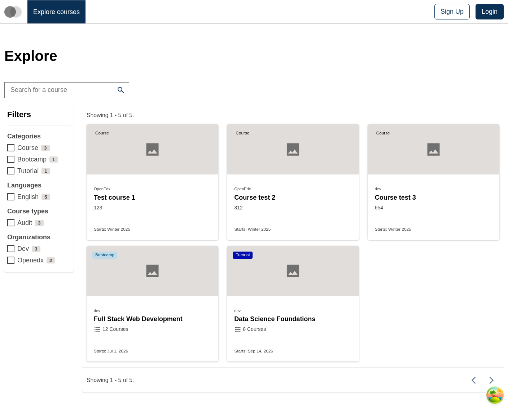
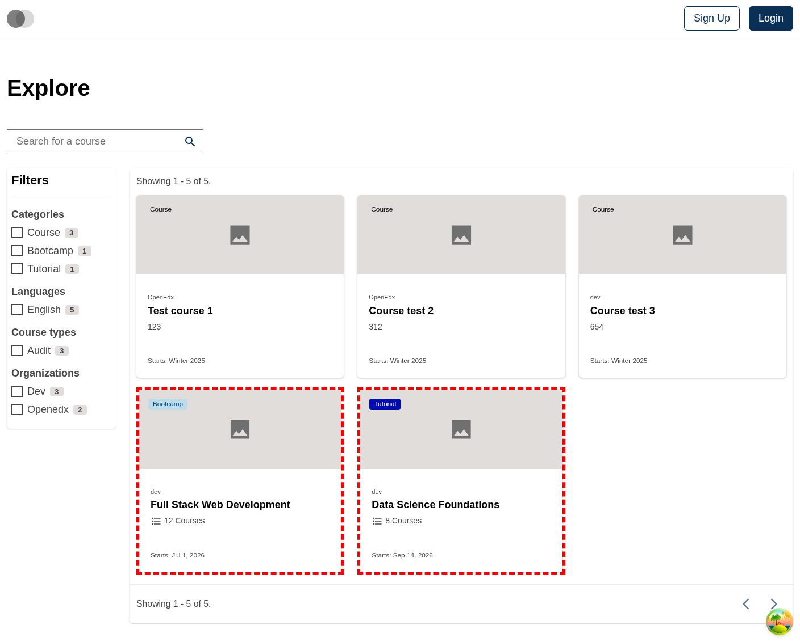
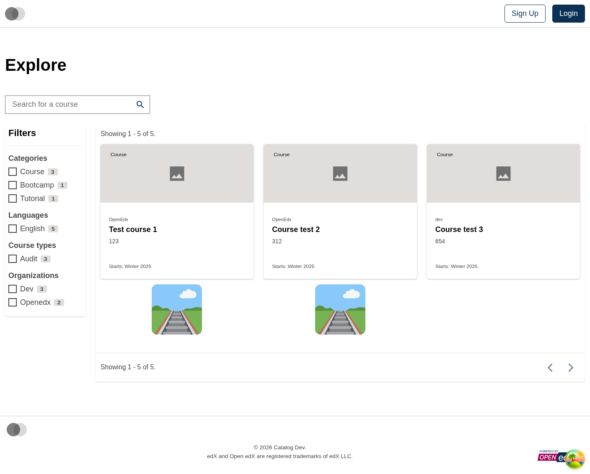
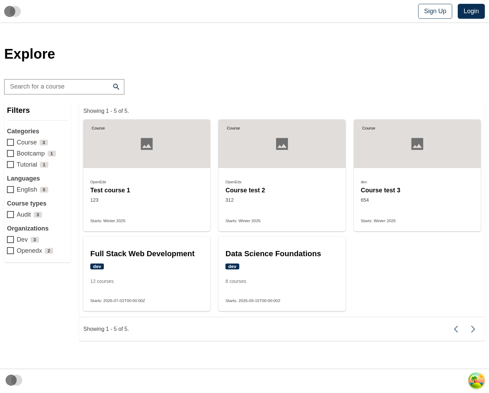

# Course Catalog Data Table Pathway Card Slot

### Slot ID: `org.openedx.frontend.slot.catalog.courseCatalogDataTablePathwayCard.v1`

### Slot Props

* `isLoading?: boolean` — whether the card is in a loading state.
* `pathwayId?: string` — the pathway's unique identifier.
* `name?: string` — the pathway's display name.
* `org?: string` — the organization offering the pathway.
* `itemCount?: number` — how many items the pathway contains.
* `imageUrl?: string` — URL of the pathway image.
* `startDate?: string` — the pathway's start date in ISO format.
* `advertisedStart?: string` — the pathway's advertised start date.
* `category?: string` — the pathway's category slug.
* `categoryLabel?: string` — the pathway's category label, shown as a badge when set.
* `categoryBackgroundColor?: string` — optional CSS color for the badge background.
* `categoryTextColor?: string` — optional CSS color for the badge text.

## Description

This slot is used to replace/modify/hide an entire Course catalog page data table pathway card.

## Examples

### Default content



### Wrapped with a red border (custom layout)



To keep the default content but wrap it in extra markup, replace the slot's **layout**.

```diff
-import { EnvironmentTypes, SiteConfig, ... } from '@openedx/frontend-base';
+import { EnvironmentTypes, LayoutOperationTypes, SiteConfig, useWidgets, ... } from '@openedx/frontend-base';

 import { catalogApp } from './src';

 import '@openedx/frontend-base/shell/style';

+const BorderedLayout = () => {
+  const widgets = useWidgets();
+  return (
+    <div className="d-flex flex-column flex-fill" style={{ border: 'thick dashed red' }}>
+      {widgets}
+    </div>
+  );
+};
+
 const siteConfig: SiteConfig = {
   // ...
   apps: [
     // ...
     {
       ...catalogApp,
+      slots: [
+        {
+          slotId: 'org.openedx.frontend.slot.catalog.courseCatalogDataTablePathwayCard.v1',
+          op: LayoutOperationTypes.REPLACE,
+          component: BorderedLayout,
+        },
+      ],
     },
   ],
 };
```

### Replaced with a simple custom component



Add the following to your site config to replace the pathway card entirely (in this case with a large "🛤️" `div`).

```diff
-import { EnvironmentTypes, SiteConfig, ... } from '@openedx/frontend-base';
+import { EnvironmentTypes, WidgetOperationTypes, SiteConfig, ... } from '@openedx/frontend-base';

 const siteConfig: SiteConfig = {
   // ...
   apps: [
     // ...
     {
       ...catalogApp,
+      slots: [
+        {
+          slotId: 'org.openedx.frontend.slot.catalog.courseCatalogDataTablePathwayCard.v1',
+          id: 'customDataTablePathwayCard',
+          op: WidgetOperationTypes.REPLACE,
+          relatedId: 'defaultContent',
+          element: <div className="d-flex align-items-center justify-content-center flex-fill pb-4 display-4">🛤️</div>,
+        },
+      ],
     },
   ],
 };
```

### Replaced with a custom component using the slot's props



Add the following to your site config to replace the pathway card with a custom card that uses the slot's props.

```diff
-import { EnvironmentTypes, SiteConfig, ... } from '@openedx/frontend-base';
+import { EnvironmentTypes, WidgetOperationTypes, SiteConfig, ... } from '@openedx/frontend-base';

-import { catalogApp } from './src';
+import { catalogApp, type CourseCatalogDataTablePathwayCardSlotProps } from './src';

+import { Card, Badge } from '@openedx/paragon';
+import { Link } from 'react-router-dom';
+
 import '@openedx/frontend-base/shell/style';

+const customPathwayCard = ({
+  isLoading,
+  pathwayId,
+  name,
+  org,
+  itemCount,
+  startDate,
+}: CourseCatalogDataTablePathwayCardSlotProps) => {
+  if (isLoading) { return <Card isLoading />; }
+  if (!pathwayId) { return null; }
+
+  return (
+    <Card as={Link} to={`/pathways/${pathwayId}`} isClickable>
+      <Card.Header
+        title={name}
+        subtitle={<Badge>{org}</Badge>}
+      />
+      <Card.Section>
+        <p className="text-muted small">{itemCount} courses</p>
+      </Card.Section>
+      <Card.Footer textElement={startDate ? `Starts: ${startDate}` : ''} />
+    </Card>
+  );
+};
+
 const siteConfig: SiteConfig = {
   // ...
   apps: [
     // ...
     {
       ...catalogApp,
+      slots: [
+        {
+          slotId: 'org.openedx.frontend.slot.catalog.courseCatalogDataTablePathwayCard.v1',
+          id: 'customDataTablePathwayCard',
+          op: WidgetOperationTypes.REPLACE,
+          relatedId: 'defaultContent',
+          component: customPathwayCard,
+        },
+      ],
     },
   ],
 };
```
